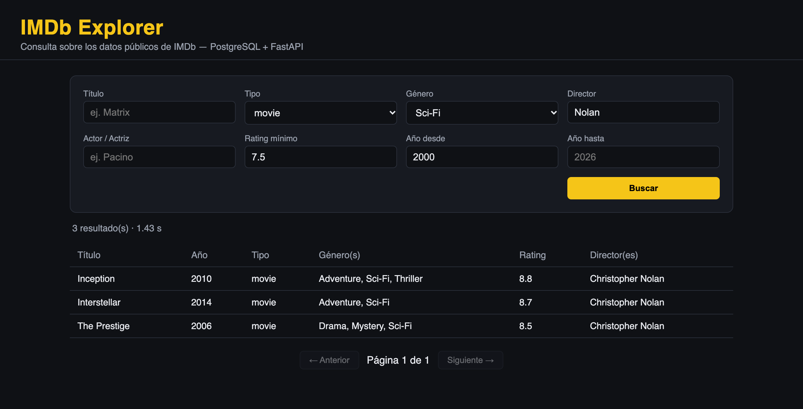

# IMDb Explorer

**English** | [Español](README.es.md)

A website to search IMDb with filters by title, type, genre, director,
actor/actress, minimum rating and year range. Portfolio project: FastAPI
backend with dynamic SQL over PostgreSQL (hosted for free on Neon), plain
HTML/JS frontend, packaged with Docker.

> **Live demo:** _link coming soon_. It runs on Render's free plan, which
> sleeps after ~15 minutes without traffic: the first visit can take
> 30–60 seconds to load. It is not broken, just waking up.



> The interface and the API field names are in Spanish; this README
> explains them in English.

## Features

- Title search with partial name matching.
- Combinable filters: title type, genre, director, actor/actress,
  minimum rating, year range.
- Paginated results.
- Title detail view: basic info, main cast, director(s) and writer(s).

## Stack

| Layer       | Technology                                        |
|-------------|---------------------------------------------------|
| Backend     | FastAPI (Python), dynamic SQL queries             |
| DB driver   | psycopg 3 + psycopg_pool (connection pool)        |
| Database    | PostgreSQL on Neon (free plan, ~340 MB)           |
| Frontend    | HTML + CSS + vanilla JavaScript                   |
| Packaging   | Docker / docker-compose (`web` service)           |

## Getting started

The database does not live on your computer: it is hosted on
[Neon](https://neon.tech) (free plan, 0.5 GB) and is filled straight from
IMDb's public datasets, without downloading anything to disk.

1. Create a Neon account and project, and copy the connection string
   (*Dashboard → Connect*).
2. Set up the project:

   ```bash
   git clone https://github.com/danielhdzr/imdb-explorer.git
   cd imdb-explorer
   cp .env.example .env      # paste your DATABASE_URL there
   python3 -m venv venv && venv/bin/pip install -r requirements.txt
   ```

3. Load the data (once, a few minutes depending on your connection):

   ```bash
   set -a; source .env; set +a
   venv/bin/python cargar_datos.py
   ```

4. Start the site, with Docker or directly:

   ```bash
   docker compose up -d --build
   # or: venv/bin/uvicorn main:app --port 8001 --env-file .env
   ```

The site runs at **http://localhost:8001**.

> **About the data**: to fit in the free plan, only titles with at least
> 200 votes are loaded (~173k: every well-known movie and series), without
> individual TV episodes or alternative titles. The threshold can be
> changed with `--min-votos`. Details in
> [DOCUMENTACION.md](DOCUMENTACION.md) (Spanish).

## API

| Method | Route                    | Description                         |
|--------|--------------------------|-------------------------------------|
| GET    | `/api/generos`           | Fixed list of IMDb genres           |
| GET    | `/api/tipos`             | Fixed list of title types           |
| GET    | `/api/peliculas`         | Search with filters + pagination    |
| GET    | `/api/pelicula/{tconst}` | Full detail of a title              |

`/api/peliculas` parameters: `titulo` (title), `tipo` (type), `genero`
(genre), `director`, `actor`, `rating_min`, `year_min`, `year_max`,
`page`. Interactive docs at http://localhost:8001/docs.

## Technical documentation

The database schema, endpoint design, how queries are built with dynamic
filters, and the project's design decisions are described in
[DOCUMENTACION.md](DOCUMENTACION.md) (Spanish).

## Project structure

```
imdb-explorer/
├── Dockerfile
├── docker-compose.yml
├── .env.example
├── cargar_datos.py      # streams IMDb → Postgres
├── main.py              # FastAPI API + static frontend
├── requirements.txt
├── screenshots/
│   └── busqueda.png
└── static/
    ├── index.html
    ├── style.css
    └── app.js
```
